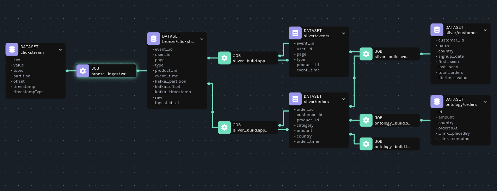

# Lakehouse

A small Foundry-style data platform on Apache Iceberg. Clickstream events land raw in a **bronze** layer, get cleaned into **silver** tables, and are mapped into business objects (Customer, Product, Order) by an **ontology**. Every build records exactly what it read, lineage shows how everything connects, and a REST API serves objects instead of tables.

```
Kafka -> bronze (raw, append-only) -> silver (clean, de-duplicated) -> ontology (business objects) -> REST API
              BronzeIngest                 SilverBuild                    OntologyBuild             Spring Boot + Trino
```

Events come from the [clickstream project](https://github.com/skdebela/clickstream-platform), which runs Kafka and the event generator.

## Stack

| Component | What it does | URL |
|---|---|---|
| Silo | S3-compatible object storage (a maintained MinIO fork) | console http://localhost:9001, S3 API :9002 |
| Iceberg REST catalog | Tracks tables and their snapshots | http://localhost:8181 |
| Spark 4.1 | Runs the ingestion and build jobs (locally) | http://localhost:4040 while a job runs |
| Trino | SQL engine the API queries through | http://localhost:8090 |
| Marquez | Stores and draws lineage | UI http://localhost:3001, API :5002 |
| Ontology API | Spring Boot REST API over ontology objects | http://localhost:8070 |

Requirements: Docker, **JDK 21** (the build refuses to run on anything else, since Spark 4.1 targets it), Maven.

## Layout

```
ontology/   ontology.yaml + loader and rules (no Spark, shared by jobs and api)
jobs/       Spark jobs: BronzeIngest, ReferenceData, SilverBuild, OntologyBuild, Query, CatalogSmokeTest
api/        Spring Boot API serving ontology objects through Trino
trino/      Trino catalog config
compose.yaml
```

## Getting started

```bash
docker compose up -d
mvn -q install
```

Two shell helpers save a lot of typing:

```bash
export SPARK_LOCAL_IP=127.0.0.1
job() { mvn -q -pl jobs exec:exec -Djob=com.skdebela.lakehouse.$1; }
q()   { SQL="$1" mvn -q -pl jobs exec:exec -Djob=com.skdebela.lakehouse.Query; }
```

Run `mvn -q install` again whenever you change `ontology.yaml` or anything in the `ontology` module.

### Smoke test

```bash
job CatalogSmokeTest
```

It creates a table, inserts twice, and time-travels back to the first snapshot. In the Silo console under `warehouse/bronze/smoke_test/` you can see how Iceberg works: `data/` holds one Parquet file per insert, `metadata/` holds one version per commit. Files are never changed; each commit adds new ones and the catalog points to the latest version.

### Bronze: ingest raw events

Start the clickstream stack and its generator first, then:

```bash
job ReferenceData   # users and products, once
job BronzeIngest    # streams Kafka into lake.bronze.clickstream_events, keeps running
```

Bronze keeps everything as it arrived, including duplicates, late events, the raw JSON and the exact Kafka partition and offset of every row. It commits a snapshot about once a minute.

```bash
q "SELECT type, count(*) FROM lake.bronze.clickstream_events GROUP BY type"
q "SELECT event_id, kafka_partition, kafka_offset, raw FROM lake.bronze.clickstream_events LIMIT 3"
```

Any partition/offset pair can be looked up in Kafka UI to find the original message.

### Silver: clean and build

```bash
job SilverBuild
```

Each build reads only the bronze snapshots added since the last successful build, de-duplicates on `event_id`, and builds `silver.events`, `silver.orders` and `silver.customers`. Bad rows go to `silver.rejected_events` with a reason, never silently dropped. Run it again with no new data and it does nothing.

Every build is logged, and every write is stamped with its build ID, code version and input snapshot:

```bash
q "SELECT build_id, status, previous_snapshot, input_snapshot, rows_processed, rows_rejected
   FROM lake.meta.builds ORDER BY finished_at"

q "SELECT committed_at, summary['build_id'], summary['input.lake.bronze.clickstream_events']
   FROM lake.silver.orders.snapshots ORDER BY committed_at DESC"
```

Each build's `previous_snapshot` is the previous build's `input_snapshot`, an unbroken chain. To check correctness, `count(*)` of `silver.events` should equal `count(DISTINCT event_id)` of bronze `VERSION AS OF` the latest `input_snapshot`.

To see rejects, send a couple of bad messages from the clickstream folder (`docker compose exec kafka /opt/kafka/bin/kafka-console-producer.sh --bootstrap-server localhost:9092 --topic clickstream`), e.g. `this is not json`, wait a minute, rebuild, and run `q "SELECT reason, raw, kafka_partition, kafka_offset FROM lake.silver.rejected_events"`.

### Ontology: business objects

```bash
job OntologyBuild
```

`ontology/src/main/resources/ontology.yaml` maps business names to columns (`lifetimeValue: lifetime_value`) and defines links between objects (Order `placedBy` Customer, with the inverse Customer `orders`). The build checks the definition against the real data before writing anything, then writes one table per type into `lake.ontology`.

```bash
q "SELECT id, name, totalOrders, round(lifetimeValue, 2) FROM lake.ontology.customers
   ORDER BY lifetimeValue DESC LIMIT 5"
```

Try breaking it: misspell a field (`primarykey`), point `titleProperty` at a property that doesn't exist, or map `lifetimeValue` to a column that isn't there. Each one fails loudly with a clear message, before anything is written. That's the point of the ontology: when silver changes, one line of mapping changes, and everything built on `Customer.lifetimeValue` keeps working.

### Lineage

Every Spark job reports lineage to Marquez automatically through the OpenLineage listener. Open http://localhost:3001, pick the `lakehouse` namespace, open a dataset and raise the depth to see the full chain:



Switch to column mode to trace a single value, e.g. `Customer.lifetimeValue` back to `price` in `bronze.products`. Set `OPENLINEAGE_ENABLED=false` to run jobs without Marquez.

Marquez answers *what depends on what*; the build log and snapshot properties answer *which version exactly*.

### The API

```bash
mvn -pl api spring-boot:run
```

```bash
curl -s localhost:8070/ontology
curl -s localhost:8070/objects/Customer/user-42
curl -s "localhost:8070/objects/Customer?country=ET&limit=3"
curl -s localhost:8070/objects/Customer/user-42/links/orders
curl -s localhost:8070/objects/Order/<order-id>/links/placedBy
```

Every name in the responses comes from `ontology.yaml`, not from a table, and each object carries `$links` to related objects. Type, property and link names are only accepted if the ontology defines them, and values are always query parameters, so the API can't be used to inject SQL. Errors use the standard problem format (RFC 9457).

## Things worth knowing

- **Caching hides lineage.** A cached DataFrame or `CACHE TABLE` replaces the real table read in Spark's plan, so the lineage listener loses the input. The jobs use plain temp views instead and accept the extra reads.
- **Trino lowercases column names.** The ontology uses camelCase, so the API maps names back, and the ontology rules forbid two properties that differ only by case.
- **Spring Boot is imported as a BOM**, not used as the parent pom, so the parent pom sets `-parameters` on the compiler itself. Without it, `@PathVariable` can't find parameter names.
- **Keep Jackson 3 aligned.** The ontology module and Spring Boot both use Jackson 3; check with `mvn -q -pl api dependency:tree -Dincludes='tools.jackson*'` that only one version appears.
- **The REST catalog is a test fixture** (`apache/iceberg-rest-fixture`), with its SQLite file on a volume so tables survive restarts. A real deployment would use Lakekeeper or Apache Polaris; Spark and Trino talk to them the same way.
- **Trino is too slow for per-request lookups** at scale. The next step would be to copy ontology objects into Postgres after each build and add a `PostgresObjectStore` behind the same `ObjectStore` interface.

## Resetting

```bash
docker compose down -v
rm -rf /tmp/checkpoints/lakehouse
```